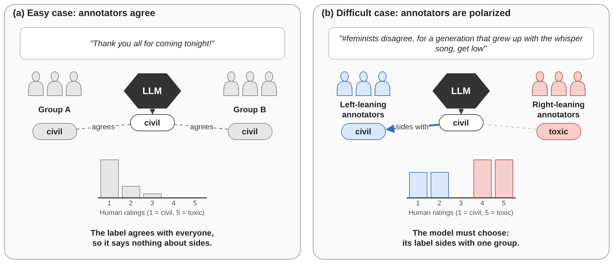
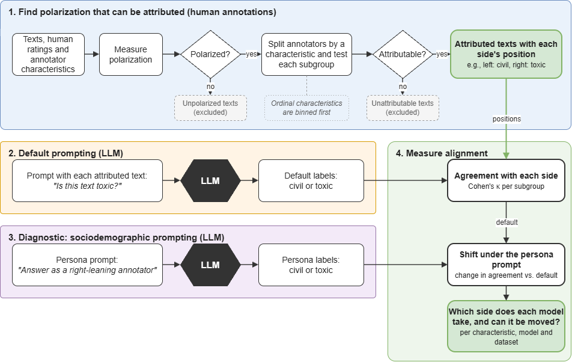

# Polarization Auditing Framework for LLMs

**Whose perspective does an LLM's label reflect?** When people disagree about a text, a language model's single label sides with someone. This repository holds the
`perspective-audit` Python package, its documentation and tutorials, and the code that reproduces the paper
*Polarization Auditing Framework for LLMs: a Toxicity Detection Study* (this repository follows the **current version of the paper**).



## What the audit does



1. **Detect polarization.** Each text gets a DFU score (distance from unimodality). A text with DFU above 0 is polarized.
2. **Attribute it.** A polarized text is *attributed* to a characteristic (gender, politics, age, ...) when every group of that characteristic is internally unimodal
   (a-posteriori unimodality, AU). Groups that take part in fewer than 10 attributed texts are removed (the 10-text rule).
3. **Ask the models.** Your prompt, your models, optionally with a persona ("answer as a ... annotator").
4. **Measure alignment.** Cohen's kappa between the model's labels and each group's position, with bootstrap intervals, a chance check and an analysis of which pole the model takes.

## Repository layout

| folder | what it is |
|---|---|
| [`perspective_audit/`](perspective_audit) | **the package** (published on PyPI as `perspective-audit`): source in `src/`, tests, the tutorials in [`docs/`](perspective_audit/docs) and [`notebooks/`](perspective_audit/notebooks) |
| [`paper/`](paper) | **the paper's code**: rebuilds its tables and figures from the saved results. Not part of the package, see [`paper/README.md`](paper/README.md) |
| `new_results/` | the saved results of the paper (AU tables, model runs, kappa tables, figures) |
| `datasets/` | the raw datasets (kept local, not in the repository: see [Data](perspective_audit/docs/reference.md#data) for where to get them) |

## Install

```bash
pip install perspective-audit                                  # the AU analysis
pip install "perspective-audit[plots,openai,gemini]"           # figures and the model providers you use
```

From a clone of this repository (to run the tutorials and the paper code):

```bash
pip install -e "perspective_audit[all-models,plots,test]"
pip install jupyter
```

## Try it in a minute (no data, no keys)

```python
from perspective_audit import run_dataset
from perspective_audit.toy import toy_spec, toy_ratings

result = run_dataset(toy_spec(), raw=toy_ratings())
print(result.describe())
result.per_dimension        # attributed texts per characteristic
result.per_group            # attributed texts per group
```

## Tutorials

One short document and one runnable notebook per step. All of them run on the built-in toy dataset, so they need no download and no API key.

| Step | Read | Run |
|---|---|---|
| 1. Load and clean a dataset, add your own | [01_data.md](perspective_audit/docs/01_data.md) | [01_data.ipynb](perspective_audit/notebooks/01_data.ipynb) |
| 2. Polarization (DFU) | [02_polarization.md](perspective_audit/docs/02_polarization.md) | [02_polarization.ipynb](perspective_audit/notebooks/02_polarization.ipynb) |
| 3. Attribution (AU, the 10-text rule, chance check) | [03_attribution.md](perspective_audit/docs/03_attribution.md) | [03_attribution.ipynb](perspective_audit/notebooks/03_attribution.ipynb) |
| 4. Describing a dataset (EDA) | [04_eda.md](perspective_audit/docs/04_eda.md) | [04_eda.ipynb](perspective_audit/notebooks/04_eda.ipynb) |
| 5. Annotating with LLMs (your prompt, your model) | [05_llm_annotation.md](perspective_audit/docs/05_llm_annotation.md) | [05_llm_annotation.ipynb](perspective_audit/notebooks/05_llm_annotation.ipynb) |
| 6. Persona (sociodemographic) prompting | [06_persona_prompting.md](perspective_audit/docs/06_persona_prompting.md) | [06_persona_prompting.ipynb](perspective_audit/notebooks/06_persona_prompting.ipynb) |
| 7. Prompt sensitivity check | [07_prompt_sensitivity.md](perspective_audit/docs/07_prompt_sensitivity.md) | [07_prompt_sensitivity.ipynb](perspective_audit/notebooks/07_prompt_sensitivity.ipynb) |
| 8. The models: description and comparison | [08_model_eda.md](perspective_audit/docs/08_model_eda.md) | [08_model_eda.ipynb](perspective_audit/notebooks/08_model_eda.ipynb) |
| 9. Alignment (kappa, chance, poles) | [09_alignment.md](perspective_audit/docs/09_alignment.md) | [09_alignment.ipynb](perspective_audit/notebooks/09_alignment.ipynb) |

More documentation:

- [**Parameters**](perspective_audit/docs/parameters.md): every rule is an argument (keep all AU texts with `min_au_texts=0`, use a threshold of 5, change the toxic cut-off, ...).
- [**Reference**](perspective_audit/docs/reference.md): API keys, choosing models, writing prompts, the output files, troubleshooting, the package layout.

## Your own data, prompt and model

```python
from perspective_audit import DatasetSpec, ModelHub, annotate, load_model_inputs, run_dataset, save_au_tables

spec = DatasetSpec(
    name="mydata",
    load=lambda root: my_dataframe,        # columns: item_id, text, rating, plus one column per characteristic
    dimensions={"gender": ("gender", {"m": "man", "f": "woman"}),
                "politics": ("politics", {"l": "left", "r": "right"})},
)
result = run_dataset(spec, raw=my_dataframe, min_au_texts=10)
save_au_tables({"mydata": result.au}, "results")

def my_prompt(texts, item):
    return f"Rate how toxic each {item} is from 1 to 5.\nFormat: score=<n>, label=<toxic/civil>\n\n{texts}"

hub = ModelHub.from_env()                                       # keys from your .env
annotate(hub["chatgpt"], load_model_inputs("results/aposteriori_for_models.csv"), "results", prompt=my_prompt, run="baseline")
```

## Reproducing the paper

The code that rebuilds the paper's tables and figures is in [`paper/`](paper), with its own notebook
[`Datasets.ipynb`](paper/notebooks/Datasets.ipynb) that goes through the paper section by section, and
[`polarization_metrics.ipynb`](paper/notebooks/polarization_metrics.ipynb) for the choice of DFU. The saved results are in `new_results/`.

> **Careful:** the paper notebook has a switch `RUN_MODELS` that is currently `True`. Running its model cells calls the paid APIs with your keys. Set it to `False` to read the saved runs.

## Tests

```bash
cd perspective_audit && pytest      # the package (stand-in models: no keys, no network, no credits)
cd paper && pytest                  # the paper's code
```

## Cite

*Polarization Auditing Framework for LLMs: a Toxicity Detection Study.* (authors anonymous for review)
