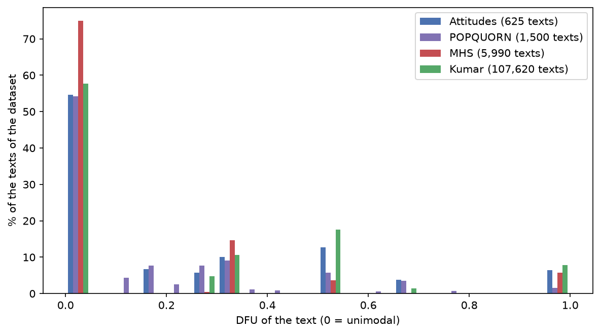

# Polarization (DFU)



A text is **polarized** when its ratings are not unimodal. We measure this with the **DFU** (distance from unimodality, from the `ndfu` package): 0 for a unimodal
histogram of ratings, larger for a more split one. A text with DFU above the `tolerance` (default 0) is polarized.

```python
from perspective_audit import Unimodality

tool = Unimodality()                       # scale 1-5
tool.dfu([1, 1, 2, 5, 5, 4])               # polarized: > 0
tool.dfu([1, 1, 2, 2, 3, 1])               # unimodal: 0
```

`tolerance` lets you accept a tiny dip as noise for large groups (`Unimodality(tolerance=0.05)`).

DFU says that a text is polarized, not *why*. The next step finds the characteristic that explains it: [03_attribution](03_attribution.md).

**Notebook:** [02_polarization.ipynb](../notebooks/02_polarization.ipynb). The comparison of several polarization metrics on synthetic distributions (the choice of DFU in the paper) is in
the repository notebook `notebooks/polarization_metrics.ipynb`.
