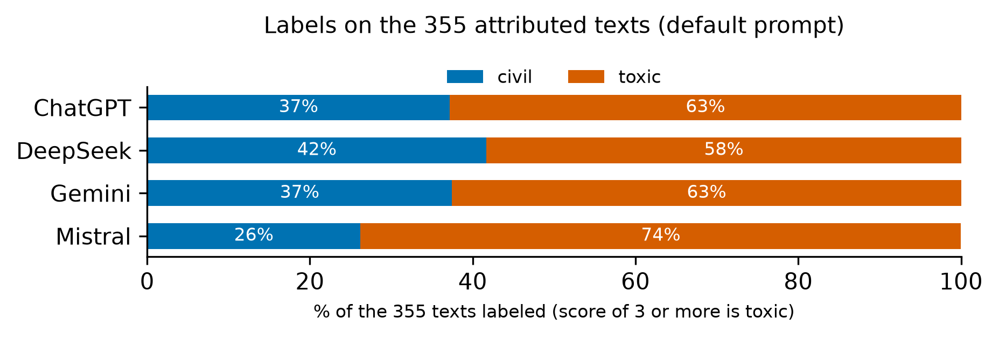

# The models: description and comparison



Before looking at alignment with the groups, look at the models themselves. Nothing here calls a model: it reads the default-prompt ratings you saved (`<dataset>/baseline/<model>.csv`).

```python
from perspective_audit import compare_models, model_eda, save_model_eda

tables = model_eda("results", datasets=["mydata"], models=["chatgpt", "gemini"])
tables["scores"]     # how each model uses the 1-5 scale
tables["labels"]     # the share of civil and toxic labels per model
save_model_eda(tables, "results/model_eda", models=["chatgpt", "gemini"])    # the two figures as pdf and png

agreement = compare_models("results", datasets=["mydata"], models=["chatgpt", "gemini"])
agreement["pairwise"]      # per pair of models: Spearman of the scores, Cohen's kappa of the labels, share of identical labels
```

- **Scores.** A model that gives almost every text a 1 or a 5 uses the scale differently from one that uses the middle. A **constant** label gives kappa 0 later, so check for it here.
- **Labels.** The share of toxic labels shows whether a model is harsher or milder than the others on the same texts.
- **Agreement between the models.** A diagnostic and not a test (no intervals): do the models order the texts alike (Spearman) and label them alike (kappa)?
  Compare it with the effect of rewording ([07](07_prompt_sensitivity.md)).
- All models must have rated the same texts: the figures assert it.

**Notebook:** [08_model_eda.ipynb](../notebooks/08_model_eda.ipynb)
