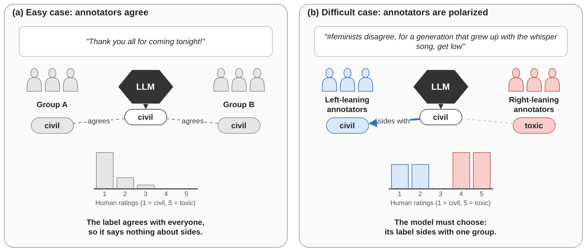
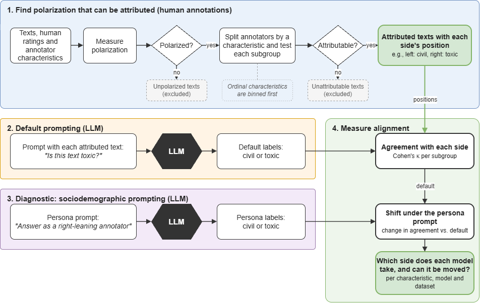

# polaudit

**An audit framework for LLM alignment with human subgroups, based on polarization.** Whose perspective does an LLM's label reflect? When people disagree about a text, a language model's single label sides with someone.
`polaudit` finds the texts where annotators are polarized, finds which annotator characteristic (gender, politics, age, ...) explains the split,
and measures which side each model takes.



## The audit in four steps

1. **Detect polarization.** Each text gets a DFU score (distance from unimodality). A text with DFU above 0 is polarized.
2. **Attribute it.** A polarized text is attributed to a characteristic when every group of that characteristic is internally unimodal (a-posteriori unimodality, AU).
   Groups in fewer than 10 attributed texts are removed.
3. **Ask the models.** Your prompt, your models, optionally with a persona.
4. **Measure alignment.** Cohen's kappa between the model's labels and each group's position, with bootstrap intervals and a chance check.



## Install

```bash
pip install polaudit                                  # the AU analysis
pip install "polaudit[plots,openai,gemini]"           # figures and the model providers you use
```

## Try it in a minute (no data, no keys)

```python
from polaudit import run_dataset
from polaudit.toy import toy_spec, toy_ratings

result = run_dataset(toy_spec(), raw=toy_ratings())
print(result.describe())
result.per_dimension        # attributed texts per characteristic
```

## Your own data, prompt and model

```python
from polaudit import DatasetSpec, ModelHub, annotate, load_model_inputs, run_dataset, save_au_tables

spec = DatasetSpec(
    name="mydata",
    load=lambda root: my_dataframe,        # columns: item_id, text, rating, plus one column per characteristic
    dimensions={"gender": ("gender", {"m": "man", "f": "woman"}),
                "politics": ("politics", {"l": "left", "r": "right"})},
)
result = run_dataset(spec, raw=my_dataframe, min_au_texts=10)     # min_au_texts=0 keeps all AU texts
save_au_tables({"mydata": result.au}, "results")

def my_prompt(texts, item):
    return f"Rate how toxic each {item} is from 1 to 5.\nFormat: score=<n>, label=<toxic/civil>\n\n{texts}"

annotate(ModelHub.from_env()["chatgpt"], load_model_inputs("results/aposteriori_for_models.csv"), "results", prompt=my_prompt, run="baseline")
```

## Full documentation

This page is the short version. The full documentation lives on GitHub, with nine tutorials (a short document and a runnable notebook each), every parameter, and the code
that reproduces the paper:

- **[Full README on GitHub](https://github.com/Swkratis210204/AUdit#readme)**: overview, repository layout, all tutorials, reproducing the paper
- [Tutorials: documents](https://github.com/Swkratis210204/AUdit/tree/main/polaudit/docs) and [notebooks](https://github.com/Swkratis210204/AUdit/tree/main/polaudit/notebooks)
- [All parameters](https://github.com/Swkratis210204/AUdit/blob/main/polaudit/docs/parameters.md)
- [Reference: API keys, models, prompts, outputs, troubleshooting](https://github.com/Swkratis210204/AUdit/blob/main/polaudit/docs/reference.md)

## The paper

This package is the code of *Polarization Auditing Framework for LLMs: a Toxicity Detection Study* (authors anonymous for review) and follows the current version of the paper.
