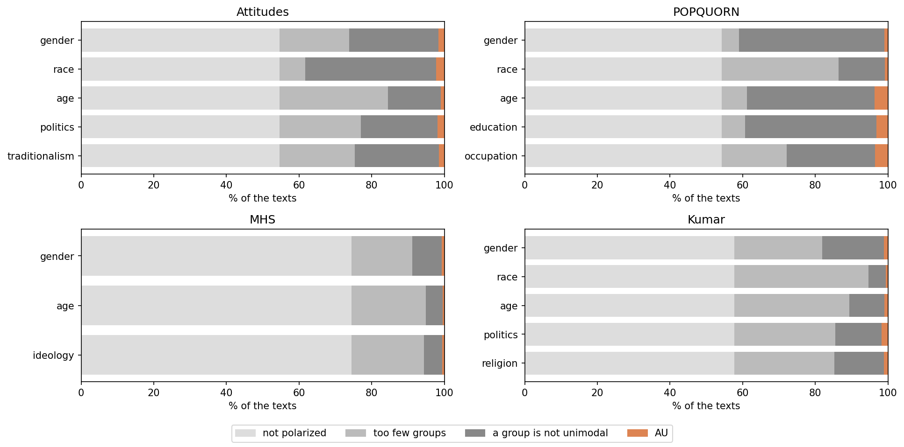

# Attribution (AU) and the 10-text rule



A polarized text is **attributed** to a characteristic (it is *a-posteriori unimodal*, AU) when, splitting the annotators by that characteristic, **every group is internally
unimodal**. The disagreement is then explained by who the annotators are, not by noise.

Two minimums make the test meaningful. A group needs at least 2 ratings on the text, and at least 2 groups must have them (`Unimodality(min_ratings=2, min_groups=2)`).

## The 10-text rule

A group that takes part in fewer than `min_au_texts` (default 10) attributed texts is a weak reference. `au_pruned` therefore, round by round:

1. counts the attributed texts of every group (a group with none counts as 0),
2. stops if no group is below 10, if only 2 groups are left, or if **every** group is below 10 (removing one would be arbitrary),
3. otherwise removes the group with the fewest texts (a tie goes to the first name), blanks its raters' group (their ratings still count for the overall DFU),
4. runs the AU test again on all texts, so texts can enter or leave the attributed set.

```python
result = run_dataset(spec, raw=df)
result.pruned["politics"].history     # the counts of every round
result.pruned["politics"].removed     # the groups removed, in order
result.au                             # the final attributed texts, one row per text and characteristic
```

## Is the attribution rate more than chance?

`attribution_gap` compares the rate of demographic and non-demographic characteristics with a bootstrap. `compute_null` deals the ratings of each text to its annotators in
every possible way (group sizes fixed, each assignment once, the observed one left out) and reruns the AU test on each, to see how many texts a characteristic
attributes by chance. It is exact: nothing is drawn at random.

```python
from polaudit import attribution_gap, compute_null

attribution_gap({"mydata": result}, reps=10_000)
compute_null({"mydata": result})                    # exclude_observed=False to keep the observed assignment
```

**Notebook:** [03_attribution.ipynb](../notebooks/03_attribution.ipynb)
