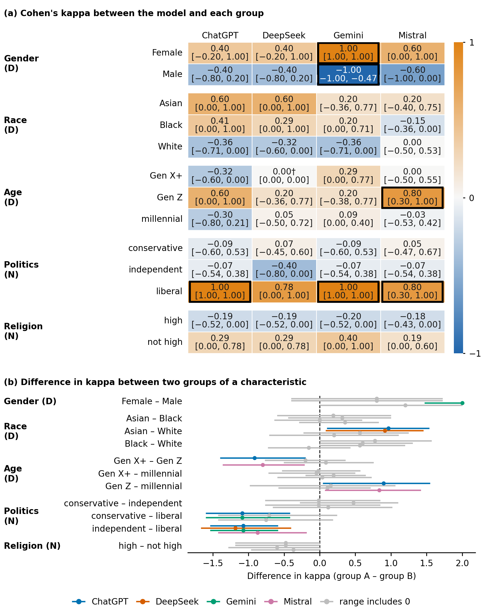
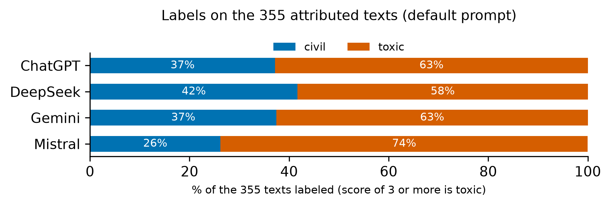

# Alignment: kappa, chance and poles



On every attributed text each group has a **position** (toxic or civil: the majority of its binary ratings, an exact tie decided by the group's mean). A model's label is its
1-5 rating binarized at 3. **Alignment** is Cohen's kappa between the model's labels and a group's positions over the attributed texts.

```python
import pandas as pd
from polaudit import compute_kappa, compute_poles

given = pd.read_csv("results/aposteriori_for_models.csv", dtype={"item_id": str})     # the texts given to the models
kappa = compute_kappa({"mydata": result}, "results", given, reps=1_000, seed=42, prompt="baseline")
kappa["by_group"]      # kappa, its 95% range and SE per group and model
kappa["gaps"]          # difference in kappa between two groups of a characteristic, "clear" if its range excludes 0
```

- **Bootstrap.** The attributed texts of a characteristic are resampled with replacement (`reps` times, fixed `seed`). Every group, model and prompt is recomputed on the same
  resamples. With only about 10 texts a kappa is uncertain: read the range, not only the number.
- **A constant model label** gives kappa 0 and is flagged (`constant_model`).
- **Poles.** `compute_poles` asks, on texts where the groups split, whether the model sides with the toxic pole or the civil pole.
- **Persona prompting.** With `prompt="scd"` and the answers of `annotate_personas`, `compute_kappa` also gives the change from the default to the persona prompt.



The paper's own tables and figures (LaTeX tables, the two-panel figures) are built by the repository folder `paper/`, not by this package.

**Notebook:** [09_alignment.ipynb](../notebooks/09_alignment.ipynb)
